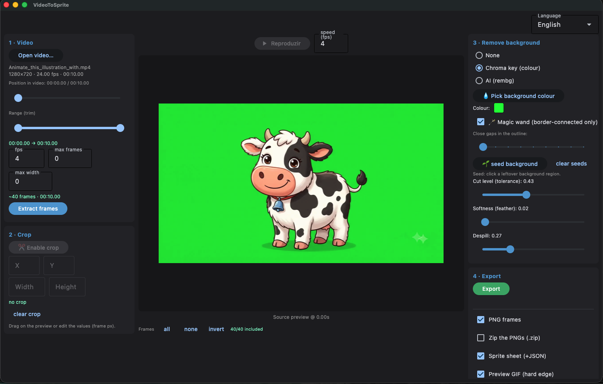
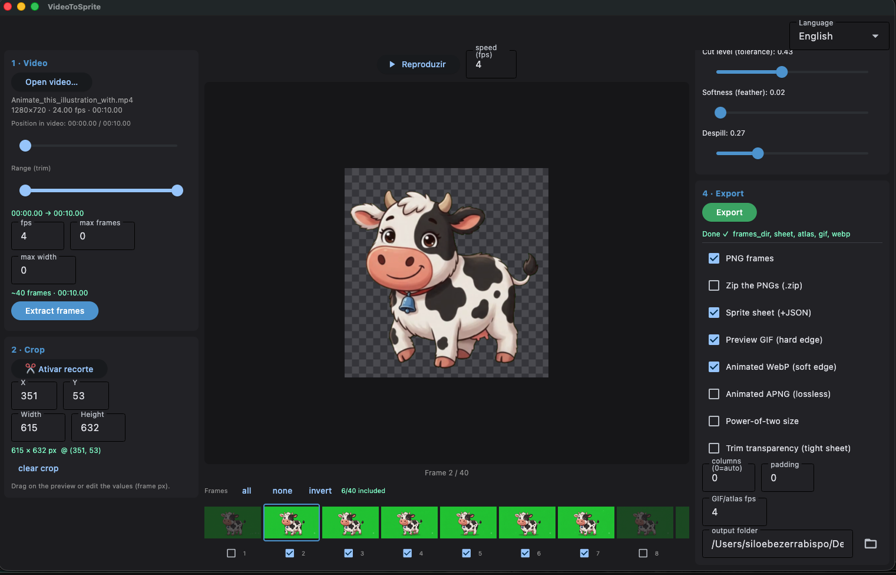

# VideoToSprite

[](https://github.com/siloebb/videoToSpriteDilo/actions/workflows/ci.yml)
[](LICENSE)
[](https://www.python.org/)


A desktop app (Python + **Flet**) that turns short videos into sprites with full
visual control: pick the frame rate, trim the time range, crop a region, select
which frames to keep, remove the background (chroma key, **magic wand**, or AI),
preview the animation, and export PNG frames, a sprite sheet, and a GIF.

## Screenshots

Open the app, load a video, trim it, choose the frame rate and extract frames.


Select frames to include, crop the region, remove background and preview the animation.


Export the final frames as PNGs, a sprite sheet, and an animated GIF/WebP/APNG.


## Requirements

- **Python 3.12** (3.10–3.12 work; 3.13+ lacks some wheels).
- **ffmpeg** and **ffprobe** — `brew install ffmpeg` (macOS), or let the app fetch
  them: if they're missing it shows a banner with an **Install ffmpeg** button that
  downloads static builds (~40 MB) into `~/.videotosprite/bin`. That in-app installer
  is **macOS-only** today; on Linux/Windows install ffmpeg yourself and the app will
  find it on `PATH`.
- Everything else is installed into a local virtualenv on first run.

> The AI background removal downloads a model (~170 MB) into `~/.u2net/` the first
> time you use it; afterwards it works offline.

## Run

```bash
./run.sh
```

On the first run this creates a virtualenv with `python3.12` (`.venv/`), installs
the dependencies, and opens the app window. After that it just launches.

To run manually:

```bash
python3.12 -m venv .venv
.venv/bin/pip install -r requirements.txt
PYTHONPATH=src .venv/bin/python -m videotosprite
```

## How to use

1. **Open a video** (panel *1 · Video*) — shows resolution / fps / duration.
2. **Trim** the time range with the double slider; the playhead previews the source.
3. Choose the **frame rate** (and optionally a max frame count / max width), then
   **Extract frames** — they appear in the thumbnail strip.
4. **Select frames**: click a thumbnail to view it; use its checkbox (or the
   *all / none / invert* buttons) to include/exclude it from the export.
5. **Crop** (panel *2 · Crop*): click **Enable crop** and drag a rectangle on
   the preview to keep only a region. The panel shows the selection's **position and
   size in pixels** and lets you **edit X / Y / width / height** directly. `Enter`
   applies, `Esc` cancels. Applies to every frame.
6. **Play** (`▶`): animated preview of the included frames; adjust the **speed (fps)**
   field live.
7. **Remove the background** (panel *3 · Remove background*) — see below.
8. **Export** (panel *4 · Export*): PNG frames (optionally zipped), a sprite sheet
   (`sheet.png` + `sheet.json` atlas), and an animated preview as **GIF**, **WebP**
   and/or **APNG** (WebP/APNG keep soft 8-bit alpha; GIF is 1-bit). *Trim
   transparency* trims each frame's transparent border and records the offset /
   source size in the atlas (TexturePacker-style tight packing). If the output
   folder already exists you're asked before overwriting. Only included frames are
   written.

Long operations (extract / AI / export) have a **cancel** button. Last-used folders
**and your settings** (fps, background mode, export options…) are remembered between
sessions — saved whenever you extract or export.

**Shortcuts:** `Space` play/pause · `←/→` step through frames · in crop mode,
`Enter` applies and `Esc` cancels.

**Language:** the UI is **English** by default; switch to **Português (BR)** with the
language selector at the top right (remembered between sessions).

## Background removal

- **Chroma key** — pick the background colour with the eyedropper (💧) and tune
  **tolerance / feather / despill** live.
  - **🪄 Magic wand** — removes only the background *connected to the image borders*,
    so same-coloured areas **inside** the subject are preserved (e.g. the white
    patches of a white cow on a white background). *Close gaps in the outline* closes
    small gaps so the background can't leak inside, and *seed background* lets
    you click any leftover background blob to remove it too.
- **AI (rembg)** — choose a model (`u2net`, `u2netp`, `isnet-general-use`), optionally
  enable **alpha matting** for finer edges, **pre-compute** the mattes once, then tune
  the **cut level** instantly.

## Tests

```bash
.venv/bin/pip install -r requirements-dev.txt
.venv/bin/python -m pytest
```

The suite runs in well under a second and needs no display. It covers the core
algorithms (chroma key + magic wand, crop, sprite-sheet packing, export, config)
and the UI logic — `tests/conftest.py` provides a mock `Page`, so handlers like
crop mapping, frame selection and the overwrite dialog are tested headlessly
(`tests/test_ui.py` is a good template for new UI tests).

Two ffmpeg integration tests need a sample clip that isn't committed; generate it
and they light up (`49 passed` instead of `47 passed, 2 skipped`):

```bash
ffmpeg -f lavfi -i testsrc=size=320x240:rate=30 -t 2 tests/sample.mp4
```

## Package as a macOS app (.app)

```bash
./build_macos.sh
```

Requires the **Flutter SDK** on your `PATH`. The first build is slow (it compiles
Flutter and bundles Python). The result is `build/macos/VideoToSprite.app` (~590 MB,
ad-hoc signed).

Two things the script handles for you, both of which otherwise fail non-obviously:

- **`flet` is pinned to the CLI's version** (`flet==0.85.2` in `requirements.txt` /
  `pyproject.toml`). The packaged Flutter shell and the Python `flet` package speak a
  version-locked protocol; if pip resolves a newer `flet` than the `flet` CLI that
  built the shell, the app opens to a **black window**. Bump both together.
- **Swift Package Manager is disabled** (`flutter config
  --no-enable-swift-package-manager`). With SPM on, the `screen_retriever_macos`
  plugin (macOS 10.14) clashes with the `FlutterFramework` SPM product (needs 10.15)
  and the Xcode build fails.

The build is **arm64 only** (`ARCH=arm64` by default in the script): `rembg` pulls in
`pymatting` → `numba`/`llvmlite`, which have no x86_64 wheels installable from an
Apple Silicon host, so a universal build has to be produced on an Intel Mac
(`ARCH="arm64 x64" ./build_macos.sh`).

`ffmpeg`/`ffprobe` are **not** embedded in the `.app` (they'd add ~90 MB and a
codesigning headache). At runtime the app looks for them on `PATH`, then in
`/opt/homebrew/bin`, `/usr/local/bin`, `/opt/local/bin`, `/usr/bin`, then in its own
`~/.videotosprite/bin` — that last one is where the banner's **Install ffmpeg**
button (`core/ffmpeg_setup.py`) downloads static, ad-hoc-signed builds. The explicit
directory list matters: an `.app` launched from Finder inherits a bare `PATH`, so a
Homebrew ffmpeg would otherwise be invisible.

## Architecture

- `core/` — UI-agnostic logic:
  - `ffmpeg.py` (probe + frame extraction), `frames.py` (frame store + matte cache +
    selection), `chroma.py` (chroma key + magic wand), `bg_ai.py` (rembg),
    `spritesheet.py` (atlas), `render.py` (frame → RGBA + crop), `export.py`
    (PNG / zip / sheet / GIF), `config.py` (persisted settings).
- `ui/` — Flet, split into panels (Flutter-style):
  - `app.py` — thin controller holding shared state (store, bg, current) and
    wiring the panels; `widgets.py` — shared builders (`card`, `LabeledSlider`);
    `imageutils.py` — numpy → PNG bytes + checkerboard for transparency;
    `i18n.py` — builds the UI in Portuguese then translates the control tree to the
    chosen language (English default), so static labels need no per-string changes.
  - `panels/` — `video_panel.py` (open/trim/extract), `preview_panel.py`
    (preview/crop drag/playback/thumbnails), `crop_panel.py` (crop coords + numeric
    editing), `bg_panel.py` (chroma/wand/AI), `export_panel.py`. Each panel owns its
    controls and handlers and calls back
    into the controller for cross-panel effects. Heavy work runs via
    `page.run_thread`.

## Stack

Flet · numpy · OpenCV (headless) · Pillow · rembg + onnxruntime · ffmpeg (native).

## Contributing

Contributions are welcome — see **[CONTRIBUTING.md](CONTRIBUTING.md)** for setup, how
to run the tests, and the three project-specific rules that will otherwise bite you
(the Portuguese-source i18n contract, the `flet` version pin, and the `core/` ↔ `ui/`
split). Please also read the [Code of Conduct](CODE_OF_CONDUCT.md). Security reports
go through [SECURITY.md](SECURITY.md).

## License

[Apache License 2.0](LICENSE) — © 2026 Siloé Bezerra Bispo.

### Third-party notices

VideoToSprite ships none of the following; each is fetched or resolved separately:

- **ffmpeg / ffprobe** are **not bundled and not linked**. The app invokes whatever
  binaries it finds on your system as external processes, and the **Install ffmpeg**
  button downloads static builds from
  [`eugeneware/ffmpeg-static`](https://github.com/eugeneware/ffmpeg-static) into
  `~/.videotosprite/bin`. Those builds carry their own licence (GPL/LGPL depending on
  the configuration) — if you redistribute them, that licence applies to them, not
  this one.
- **rembg models** (`u2net`, `u2netp`, `isnet-general-use`) are downloaded to
  `~/.u2net/` on first use and carry their own upstream licences.
- **Flet / Flutter** runtime components are bundled only into the `.app` produced by
  `build_macos.sh`, under their own licences.
- Python dependencies (numpy, OpenCV, Pillow, onnxruntime…) are installed by pip
  under their respective licences.
